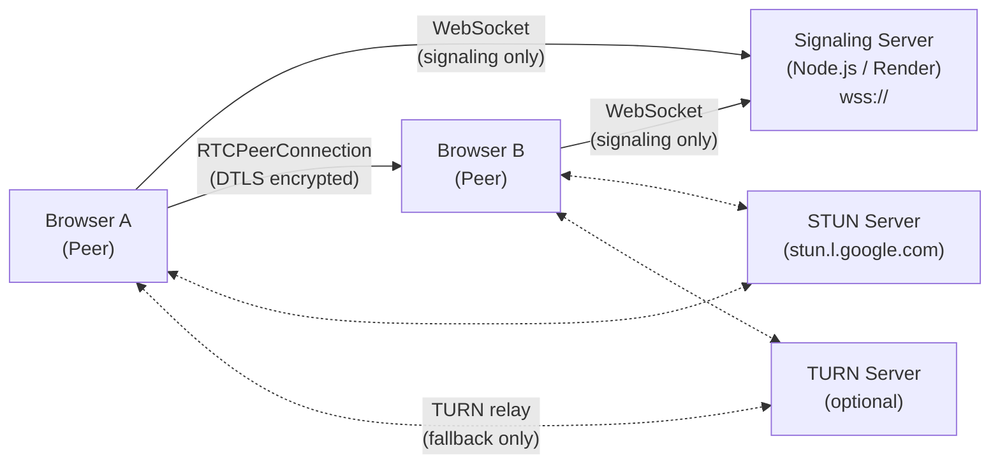

# PeerDrop

> Browser-to-browser P2P file sharing and live video streaming – your bytes never touch a server.

Built as a Computer Networks & Web Technology final project demonstrating WebRTC, ICE/STUN/TURN, DataChannels, and the perfect negotiation pattern.

## Architecture



**Key principle:** The signaling server exchanges only SDP offers/answers and ICE candidates. Zero file or media bytes pass through it. All data travels DTLS-encrypted directly peer-to-peer (or via TURN relay in symmetric NAT scenarios, still encrypted end-to-end).

## Repository structure

```
/server
  server.js         – Node.js WS signaling server
  package.json
  test-signaling.js – automated server tests
  verify-paths.js   – static file path check
  README.md
/web                – 100% static, deploys to GitHub Pages
  index.html
  styles.css
  /js
    config.js       – SIGNALING_URL, ICE servers (edit before deploy)
    main.js         – App orchestrator
    signaling.js    – WebSocket client with auto-reconnect
    peer.js         – RTCPeerConnection (perfect negotiation)
    transfer.js     – FileSender + FileReceiver (backpressure, SHA-256)
    stream.js       – Video track management
    stats.js        – getStats() poller
    ui.js           – DOM helpers, toast, transfer list
    manual-sdp.js   – Serverless copy-paste SDP fallback
    utils.js        – Shared utilities
/README.md
```

## Quickstart (local dev)

```bash
# 1. Install server deps
cd server && npm install

# 2. Start signaling server on port 3001
npm start

# 3. Serve the web folder (any static server)
npx serve ../web -p 8080
# or: python -m http.server 8080 --directory ../web

# 4. Open two tabs:
#    http://localhost:8080/?room=XXXXXX  (tab 1: create)
#    http://localhost:8080/              (tab 2: join)
```

> **Important:** Update `SIGNALING_URL` in `web/js/config.js` to `ws://localhost:3001` for local dev.

## Deploy – Render (signaling server)

1. Push the `server/` folder to a GitHub repo (or the whole repo).
2. On [render.com](https://render.com) → **New Web Service**:
   - Root directory: `server`
   - Build: `npm install`
   - Start: `npm start`
   - Instance type: **Free**
3. Set env var `ALLOWED_ORIGINS = https://yourusername.github.io`
4. After deploy, copy the service URL (e.g. `https://peerdrop-signal.onrender.com`).

## Deploy – GitHub Pages (frontend)

1. In repo settings → **Pages** → Source: **Deploy from a branch** → branch `main`, folder `/web`.
2. Update `SIGNALING_URL` in `web/js/config.js` to your Render `wss://` URL.
3. Push. Your app is live at `https://yourusername.github.io/repo-name/`.

> No build step needed. The `/web` folder is served as-is.

## TURN server (optional but recommended for demos)

The app works without TURN for most home networks. For symmetric NAT (corporate, some mobile):

1. Get a free TURN credential from [Metered](https://www.metered.ca/tools/openrelay/) or deploy [coturn](https://github.com/coturn/coturn).
2. Fill in the placeholders in `web/js/config.js`:
   ```js
   { urls: 'turn:YOUR_TURN_HOST:3478', username: '...', credential: '...' }
   ```
3. Never commit real credentials to a public repo. TURN credentials are low-risk (time-limited bandwidth), but rotate them before submission.

## Security notes

- All WebRTC data is **DTLS-encrypted** end-to-end. Even a TURN relay sees only ciphertext.
- File names are sanitized before saving (strip path traversal chars, control chars).
- All DOM text is inserted via `textContent` / `escapeHtml()` — no `innerHTML` with untrusted data.
- Signaling server validates message type, size (64 KB limit), room membership, and rate-limits connections.

## Phases completed

| Phase | Description | Status |
|-------|-------------|--------|
| 1 | Signaling + minimal client, room create/join, connection status | ✅ |
| 2 | File transfer, backpressure, SHA-256 integrity | ✅ |
| 3 | Full UI/UX, peer visualization, dark/light theme | ✅ |
| 4 | Video streaming, renegotiation | ✅ |
| 5 | Stats panel, force-relay toggle, manual SDP | ✅ |
| 6 | Hardening, edge cases, README, test checklist | ✅ |

## Test checklist

### Phase 1: Signaling Server & Connection
- [x] Signaling server starts on PORT, `/health` returns 200 JSON
- [x] `create-room` generates a unique 6-character code (A-Z, 2-9 only, no ambiguous characters like 0/O/1/I)
- [x] `join-room` notifies room creator with `peer-joined`
- [x] SDP offers, answers, and ICE candidates are relayed exclusively to the room peer
- [x] 3rd peer attempting to join receives `room-full` error
- [x] Invalid room codes rejected with human-readable error messages
- [x] Non-existent rooms return `room-not-found`
- [x] Heartbeat ping/pong every 25s prevents socket timeouts
- [x] Peer leaving emits `peer-left` and cleans up empty rooms after TTL

### Phase 2: DataChannel & File Transfer
- [x] Zero-byte files transfer instantly, creating a valid 0-byte Blob
- [x] Small files (< 50 MB) transfer with live smoothed EMA speed and ETA
- [x] Lazy chunk reading via `file.slice()` keeps memory flat (never buffers entire file in RAM)
- [x] Backpressure properly pauses sending when `bufferedAmount > 1MB` and resumes on `bufferedamountlow` (256 KB)
- [x] SHA-256 integrity check runs with `crypto.subtle` on files up to 500 MB; UI displays "✓ Verified"
- [x] Files > 500 MB verify chunk count and exact byte size
- [x] File System Access API (`showSaveFilePicker`) allows streaming directly to disk for large files
- [x] Cancellation mid-transfer sends `transfer-cancel` control packet and frees resources on both sides
- [x] Peer disconnection mid-transfer flags the transfer as failed with retry state
- [x] Tab close warning (`beforeunload`) prevents accidental navigation during active transfers

### Phase 3: UI/UX & Responsive Design System
- [x] Linear/Apple minimalist design with 8px spacing grid and 12-16px border radii
- [x] Dark mode default with refined light mode toggle (persisted to `localStorage`, respects system preference)
- [x] Animated peer visualization with glowing connection line and directional particle flow during transfers
- [x] 6-digit room code input with auto-advance, paste handling, and shake animation on error
- [x] Micro-interactions: copy button morph, toast animations, completion ring morphing into checkmark
- [x] Responsive layout tested from 360px mobile viewport to desktop
- [x] Accessible HTML with ARIA live regions, focus rings, and WCAG AA contrast

### Phase 4: Video Streaming
- [x] Video file streaming with `captureStream()` / `mozCaptureStream()` fallback
- [x] Synchronized play, pause, and seek commands sent over control channel
- [x] Screen sharing (`getDisplayMedia`) and webcam (`getUserMedia`) streaming
- [x] Perfect negotiation handles track addition and renegotiation seamlessly
- [x] Autoplay restriction handling with "Click to play" overlay
- [x] Video stats overlay (resolution, fps, bitrate) toggled by pressing the **'S'** key

### Phase 5: Network Insight & Manual SDP Fallback
- [x] `pc.getStats()` polls every second to display connection type badge (LAN / STUN / TURN)
- [x] Live metrics for RTT, throughput, bytes transferred, and data channel buffer
- [x] "Under the hood" collapsible drawer with color-coded signaling log and SDP viewer
- [x] Force relay (TURN) toggle updates `iceTransportPolicy` and triggers ICE restart
- [x] Serverless manual connection mode (copy/paste offer and answer strings with full ICE gathering)

## Troubleshooting

1. **Signaling Connection Fails on GitHub Pages**:
   - GitHub Pages serves over HTTPS (`https://`). Browsers block unencrypted WebSockets (`ws://`) as mixed content.
   - Ensure `SIGNALING_URL` in `web/js/config.js` uses `wss://` (secure WebSocket) when deployed.
   - On Render, the free tier spins down after inactivity. The first connection may take 30–50 seconds to wake the service.

2. **Peers Cannot Connect Across Different Networks**:
   - Direct connection via STUN fails if either laptop is behind a symmetric NAT (common on corporate, campus, or cellular hotspots).
   - Solution: Configure TURN credentials in `web/js/config.js` (e.g. from [Metered](https://www.metered.ca/tools/openrelay/)).

3. **Autoplay Blocked on Video Stream**:
   - Modern browsers prevent unmuted video from playing automatically without user interaction.
   - Click the "Click to play" overlay on the remote player to start playback.

4. **captureStream Not Supported**:
   - Safari on iOS does not support `video.captureStream()`. Use Chrome or Edge on desktop, or choose Screen Share / Camera instead.
